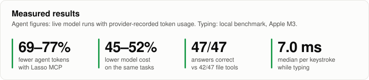
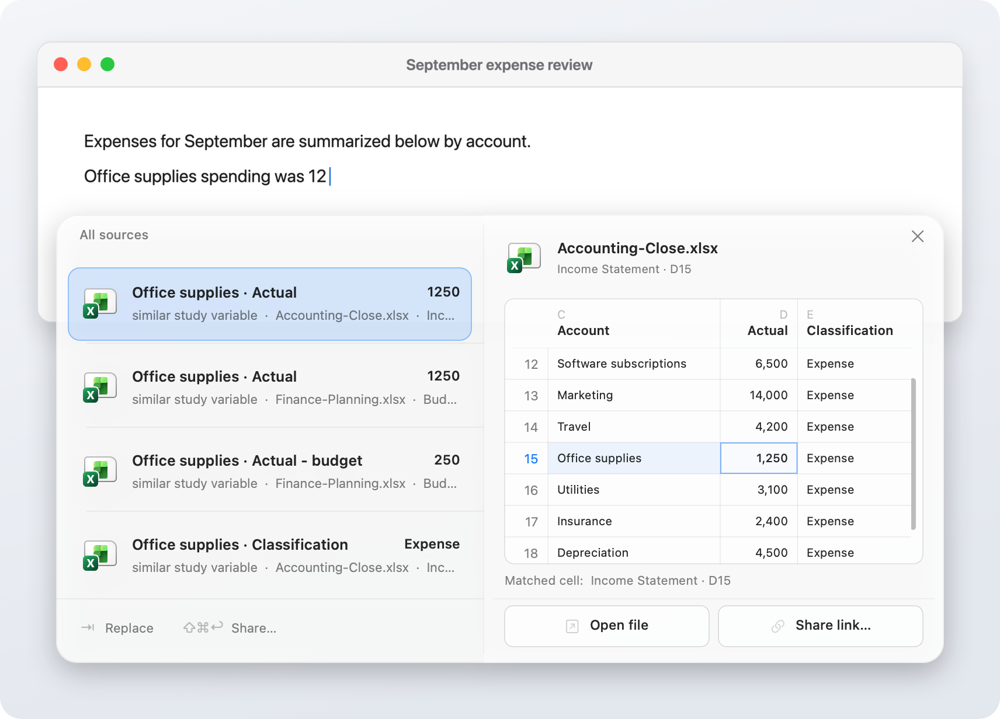
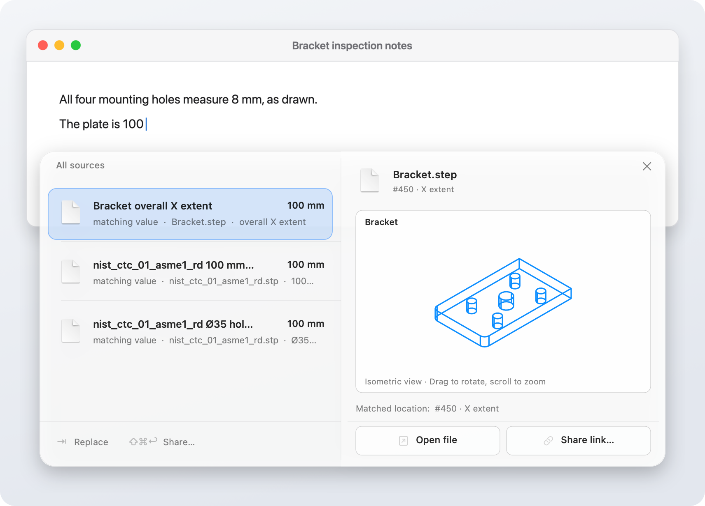
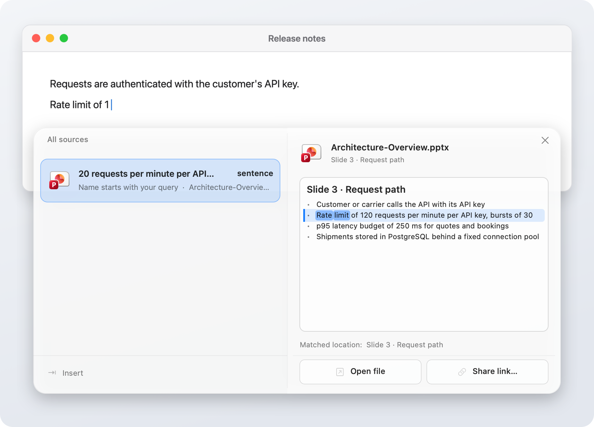
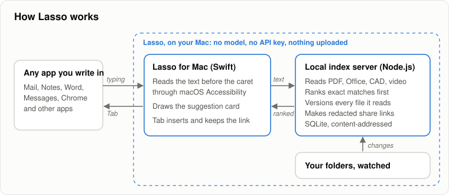
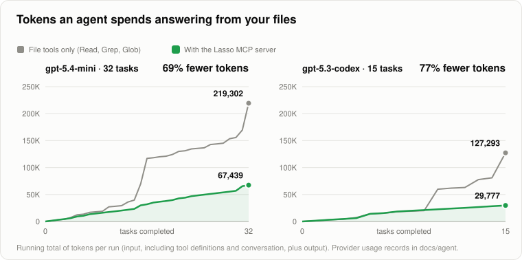
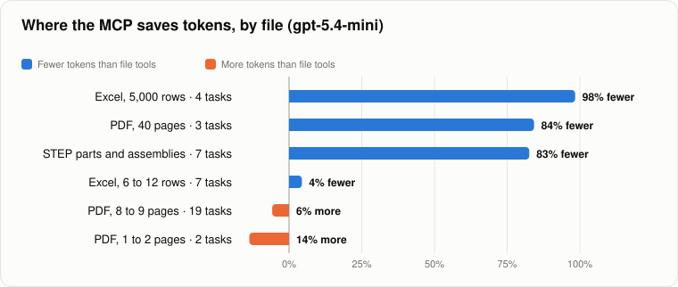
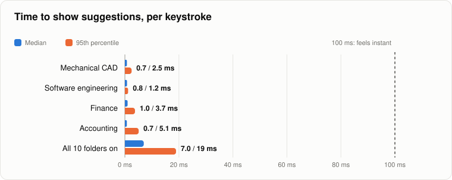

<p align="center">
  
</p>

<h1 align="center">Lasso</h1>

<p align="center"><b>Autocomplete from your own files in any Mac app, and an MCP server that answers AI agents from the same index.</b></p>

<p align="center">
  <a href="#what-it-is">What it is</a> ·
  <a href="#system-requirements">Requirements</a> ·
  <a href="#install-and-run">Install and run</a> ·
  <a href="#how-to-use-it">How to use it</a> ·
  <a href="#keyboard-shortcuts">Shortcuts</a> ·
  <a href="#lasso-mcp-for-ai-agents">MCP for AI agents</a> ·
  <a href="#benchmarks">Benchmarks</a>
</p>

<p align="center">
  
</p>

## What it is

Lasso reads the folders you choose (spreadsheets, PDFs, Word, PowerPoint, CAD models, code) and, as you type in any app, offers the exact value or sentence from those files. Press `Tab` to insert it. Every insertion remains linked to the file and version it came from.

- **Exact, not generated.** Suggestions are text that exists in your files. No language model is involved.
- **Private.** Everything runs on your Mac. No account, no API key, no upload.
- **For AI agents too.** The Lasso MCP server gives Claude, ChatGPT and other agents the same exact answers, with 69 to 77% fewer tokens than reading the files in live tests.

<p align="center">
  <picture>
    <source media="(prefers-color-scheme: dark)" srcset="docs/images/lasso-excel-value-dark.png">
    
  </picture>
  <br><sub>Typing <code>Office supplies spending was 12</code> offers the 1,250 recorded in both workbooks, with the cell shown in its sheet. <code>Tab</code> inserts it.</sub>
</p>

<details>
<summary><b>More examples</b>: a CAD measurement, a slide sentence, how it works</summary>
<br>
<picture>
  <source media="(prefers-color-scheme: dark)" srcset="docs/images/lasso-cad-value-dark.png">
  
</picture>
<p><sub>Typing <code>The plate is 100</code> offers the 100 mm extent measured from <code>Bracket.step</code>.</sub></p>
<picture>
  <source media="(prefers-color-scheme: dark)" srcset="docs/images/lasso-deck-sentence-dark.png">
  
</picture>
<p><sub>Typing <code>Rate limit of 1</code> completes the sentence from slide 3 of a PowerPoint deck.</sub></p>

</details>

## System requirements

| | Requirement |
| --- | --- |
| **Operating system** | macOS 13.5 or later. Windows 10 (1809) or later is in preview. |
| **To build from source** | Node.js 24 or later, and the Xcode Command Line Tools |
| **Permissions** | Accessibility, granted once in System Settings, so Lasso can read and insert text |
| **For the MCP server** | Any MCP host: Claude Desktop, Claude Code, Cursor and others |
| **Network** | None. Lasso works fully offline. |

The built app bundles its own Node.js, so a Mac that only runs Lasso needs nothing else installed.

## Install and run

```bash
git clone https://github.com/jte700/Lasso.git
cd Lasso
npm ci
npm run desktop
open dist/Lasso.app
```

Lasso appears in the menu bar. It starts at login from then on; after quitting, press `⌘L` to start it again.

<details>
<summary>Run only the local server, without the Mac app</summary>

```bash
npm ci
npm start                       # then open http://127.0.0.1:4317
```
</details>

## How to use it

1. Click the Lasso icon in the menu bar and choose **Add Work Directories…** to pick the folders Lasso should read.
2. Turn on **Suggest While Typing**, and allow Accessibility access when macOS asks.
3. Type in any app. After two letters of a name, value or sentence from your files, a card appears next to the caret.
4. Press `Tab` to insert the suggestion, or `↑` `↓` to choose another.
5. Press `⇧⌘R` to open **The Ranch**, Lasso's library window: every source, recent changes, share links and anything that needs review.

The [user guide](docs/user-guide.md) covers sharing, connected apps (Outlook, Google Calendar, Notion), external drives and CAD sources.

## Keyboard shortcuts

**While a suggestion card is showing**

| Keys | Action |
| --- | --- |
| `Tab` | Insert the suggestion |
| `↑` `↓` | Choose another suggestion |
| `⌘↩` | Insert as plain text |
| `⇧⌘↩` | Insert a share link to the source |
| `fn →` / `fn ←` | Narrow to the selected source / step back |
| `⌘Z` | Undo what Lasso just inserted |
| `Esc` | Dismiss |

**Anywhere**

| Keys | Action |
| --- | --- |
| `⇧⌘R` | Open The Ranch |
| `⌘L` | Start Lasso again after quitting |
| `⌘,` | Settings |

In The Ranch, `⌘1` to `⌘5` switch views and `⌘F` searches. The full list is in Settings → Shortcuts.

## Lasso MCP for AI agents

The MCP server lets an AI agent ask Lasso instead of reading your files itself. The agent sends every question in one call and gets back only the lines, cells or sentences that answer it, each with its source.

**Claude Code**

```bash
claude mcp add lasso -- node /path/to/Lasso/src/agent/cli.js mcp --scope Finance
```

**Claude Desktop and other hosts** (`mcpServers` in the host's config)

```json
{
  "mcpServers": {
    "lasso": {
      "command": "/Applications/Lasso.app/Contents/MacOS/node",
      "args": ["/Applications/Lasso.app/Contents/Resources/app/src/agent/cli.js", "mcp", "--scope", "Finance"]
    }
  }
}
```

`--scope` names the folders the agent may read (repeat it for more, or `"*"` for all). Add the folders in Lasso first. Setup, the REST API and tool reference: [docs/agent](docs/agent/README.md).

## Benchmarks

### Token savings with the MCP server

The same models answered the same tasks twice: once with only file tools (Read, Grep, Glob), once with Lasso's MCP server added. Token counts are OpenAI's own usage records for every call, including the prompt, tool definitions and reasoning.

<p align="center"></p>

| Model | Tokens, file tools | Tokens, Lasso MCP | Saved | Cost | Correct |
| --- | --- | --- | --- | --- | --- |
| gpt-5.4-mini (32 tasks) | 219,302 | 67,439 | **69%** | $0.145 → $0.080 | 29 → **32** |
| gpt-5.3-codex (15 tasks) | 127,293 | 29,777 | **77%** | $0.211 → $0.100 | 13 → **15** |

The savings depend on the file. Lasso returns the one row, sentence or measurement asked for, so large files gain most. Very small files are cheaper to read directly.

<p align="center"></p>

### Typing speed and accuracy

Suggestions refresh on every keystroke. Replaying 28 prompts one key at a time across 10 test folders (577 keystrokes on an Apple M3):

- **27 of 28** prompts got the right suggestion first; **28 of 28** within the top three.
- **7 ms** median and 19 ms p95 per keystroke with all folders on; under 1 ms with one folder.
- **0** model tokens: typing suggestions never call a language model.

<p align="center"></p>

Very large folders are the current limit: a 614-file repository with about 167,000 indexed items takes several seconds per keystroke and is left out of these runs.

<details>
<summary>Methodology and reproducing the numbers</summary>

- **MCP runs:** [`scripts/agent-benchmark-live.mjs`](scripts/agent-benchmark-live.mjs), reasoning effort low, graded against known answers. Full records: [gpt-5.4-mini](docs/agent/live-results-gpt-5.4-mini-v4.md), [gpt-5.3-codex](docs/agent/live-results-gpt-5.3-codex-v4.md), [by kind of file](docs/agent/live-results-gpt-5.4-mini-geometry+scale+writing+documents.md). Runs are small (one or two per model), and the same task can vary widely between runs; the large-file differences are consistent.
- **Typing runs:** `npm run bench` replays the prompts in [`scripts/benchmark-cases.json`](scripts/benchmark-cases.json) and writes [`docs/benchmarks/results.json`](docs/benchmarks/results.json). Set `LASSO_BENCH_ROOT` to the test folders. Each run uses a temporary library.
- **Charts:** `npm run bench:charts` redraws every chart from those files.
</details>

## Documentation

[User guide](docs/user-guide.md) · [MCP and agent API](docs/agent/README.md) · [Building and configuration](docs/building.md) · [Ranking algorithm (PDF)](docs/lasso-ranking-algorithm.pdf) · [Known limitations](docs/limitations.md)

**Development:** `npm test` runs the 876-test Node suite, `npm run desktop:test` the native checks. Source layout: `src/` local server, `desktop/` Mac app (Swift), `desktop/windows/` and `desktop-windows/` Windows preview, `test/` tests, `docs/` documentation.
