<p align="center">
  
</p>

<h1 align="center">Lasso</h1>

<p align="center"><b>The right figure, from the right file.</b><br>Lasso suggests exact figures, clauses and passages from your own files while you write in any Mac app. Press <code>Tab</code> and it goes in, linked to the file and version it came from.</p>

<p align="center">
  <a href="https://mylasso.ca">Website</a> ·
  <a href="#whats-new">What's new</a> ·
  <a href="#features">Features</a> ·
  <a href="#install-and-run">Install</a> ·
  <a href="#keyboard-shortcuts">Shortcuts</a> ·
  <a href="#lasso-mcp-for-ai-agents">MCP</a> ·
  <a href="#benchmarks">Benchmarks</a> ·
  <a href="docs/user-guide.md">User guide</a>
</p>

<p align="center">
  <picture>
    <source media="(prefers-color-scheme: dark)" srcset="docs/images/autocomplete-dark.gif">
    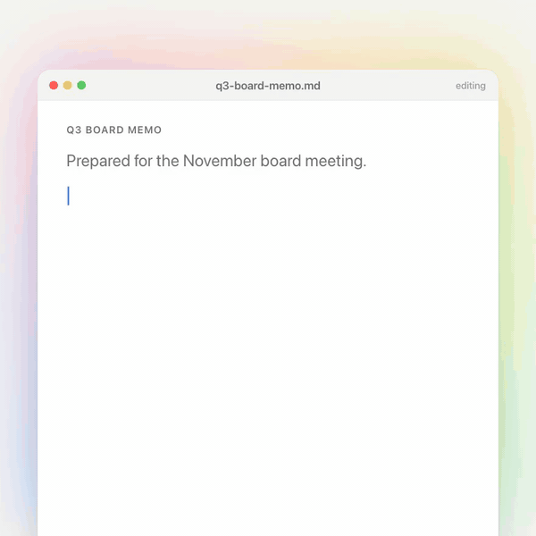
  </picture>
  <br><sub>Start typing a figure and Lasso finds the cell it came from. <code>Tab</code> inserts it with a link back to that version of the file.</sub>
</p>

<p align="center">
  
</p>

Lasso watches the folders you choose and reads what is in them: spreadsheets, PDFs, Word documents, decks, CAD models, code and recorded calls. As you write in Mail, Word, Notes, Slack, a browser or anywhere else, it offers the exact text or number from those files. Suggestions are never invented by a language model. They come straight from your files, and everything stays on your Mac unless you choose to share it.

## What's new

| Update | What it means for you |
| --- | --- |
| **`\` commands** | Start a sentence with `\` and press `Tab`. Your chosen AI writer answers in its place, using only what it finds in your Lasso folders, and every fact it uses is linked to its source. The same works in reviews: a comment that starts with `\` asks the AI to make the change. [More](#write-with-a-backslash) |
| **Cloud drives** | Google Drive (with shared drives), OneDrive (with SharePoint libraries, if you opt in), Dropbox and iCloud Drive can now be sources. Lasso only reads them. [More](#cloud-drives-usb-drives-and-connected-apps) |
| **A redesigned Loop** | The library window has a new dark look in the Figtree typeface: a file tree sidebar, a floating chip search, an audit log of recent changes, a map of how files connect, and a short tour the first time you open it. [More](#the-loop) |
| **Review Changes** | Pull-request style reviews for ordinary files. Comment on a line, a cell or a passage, apply suggested edits, ask named reviewers, then approve. [More](#review-changes) |
| **AI-written text, marked** | Text an AI wrote is bracketed in that AI's colour in other apps. Hover to see which AI wrote it and from what prompt. Word documents carry the record with them. [More](#provenance-you-can-see) |
| **Faster folder switching** | `⌥Tab` narrows suggestions to one folder. Hold it and the pill grows into a list of your folders to pick from. [More](#choose-where-suggestions-come-from) |
| **A new face** | The Lasso mascot is now the app's small logo, in the menu bar, the folder switcher, the dictation pill and The Loop. |

## Features

### Exact autocomplete, from your own files

Type a name, a figure, the start of a clause or a quoted phrase, and Lasso shows the matching source in a card by the caret. The rest of the suggestion appears as faint ghost text after the caret. Press `Tab` to insert it, or `↑` `↓` to pick another source. The card previews the cell in its sheet, the sentence on its page, the slide, the CAD part or the moment in a recording.

A suggestion only appears when your words match words in the file itself, and an exact match (a cell's row name, a value, a file name) always ranks first. The rules are written up in the [ranking algorithm](docs/lasso-ranking-algorithm.pdf).

<details>
<summary><b>See more cards</b>: PDF contracts, STEP 3D models, IFC floor plans and research reports</summary>
<br>
<p align="center">
  <picture>
    <source media="(prefers-color-scheme: dark)" srcset="docs/images/card-pdf-dark.png">
    
  </picture>
  <br><sub>From a signed PDF lease: the clause completed word for word, highlighted on its page.</sub>
</p>
<p align="center">
  <picture>
    <source media="(prefers-color-scheme: dark)" srcset="docs/images/card-cad-dark.png">
    
  </picture>
  <br><sub>From a STEP assembly: exact part dimensions, with an interactive 3D wireframe of the feature.</sub>
</p>
<p align="center">
  <picture>
    <source media="(prefers-color-scheme: dark)" srcset="docs/images/card-ifc-dark.png">
    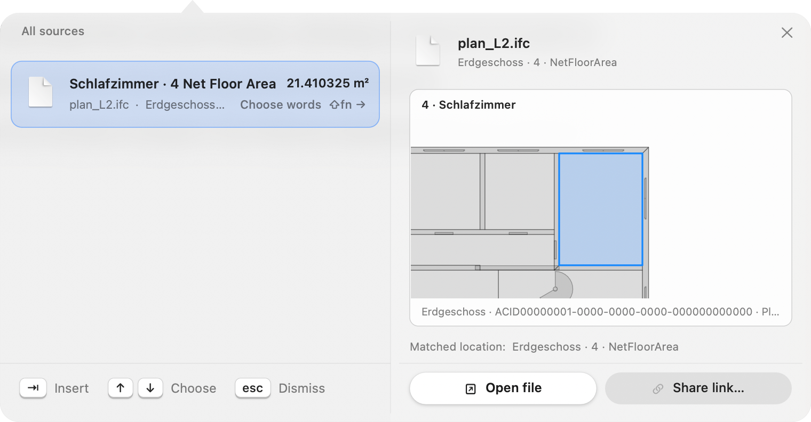
  </picture>
  <br><sub>From an IFC building model: room areas and quantities, with the room highlighted on its floor plan.</sub>
</p>
<p align="center">
  <picture>
    <source media="(prefers-color-scheme: dark)" srcset="docs/images/card-report-dark.png">
    
  </picture>
  <br><sub>From a PDF report: findings and confidence intervals, matched straight from the page.</sub>
</p>
</details>

### Write with a backslash

<p align="center">
  <picture>
    <source media="(prefers-color-scheme: dark)" srcset="docs/images/writer-dark.gif">
    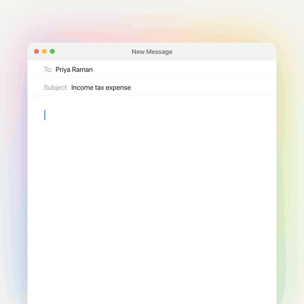
  </picture>
  <br><sub>A <code>\</code> prompt becomes a finished email, with each figure linked to the statement it came from.</sub>
</p>

Pick an AI writer with `⌥Tab` then `↓` (ChatGPT, signed in with your own account). After that, any sentence you start with `\` is a prompt:

1. Type your request, such as `\Write an email about the income tax expense`, and press `Tab`.
2. Lasso erases the prompt and the writer answers in its place. It searches your Lasso folders for what it needs and cites what it uses, and each citation becomes a linked source pill.
3. Press `Esc` to stop it at any point, or `⌘Z` to take the whole answer back.

The writer only sees your prompt and what it looks up through Lasso. Ordinary suggestions while you type never use a language model.

### Choose where suggestions come from

<p align="center">
  <picture>
    <source media="(prefers-color-scheme: dark)" srcset="website/assets/media/scope-dark.webp">
    
  </picture>
</p>

Press `⌥Tab` to narrow suggestions to one folder or connected app. They stay narrowed until you choose All again. Hold `⌥Tab` and the pill grows into a list of every switched-on folder. Pick one with `↑` `↓` and `Return`, or click it. With more than ten folders, the list shows the five you use most.

### Cloud drives, USB drives and connected apps

<p align="center">
  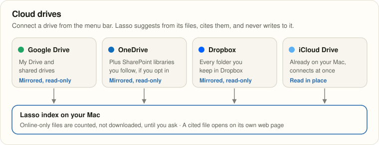
</p>

- **Cloud drives.** Connect Google Drive, OneDrive, Dropbox or iCloud Drive from the **Cloud Drives** section of the menu bar panel. Lasso suggests from their files like any other folder and opens a cited file on its own web page. It never writes to the drive, and files kept online only are not downloaded unless you ask.
- **USB drives.** Plug in a drive and Lasso asks whether to index all of it or only the folders you pick. When the drive is unplugged, you can keep its saved index to search offline.
- **Connected apps.** Outlook mail and calendar, Google Calendar, the Calendar app on your Mac, Notion and any iCal feed can be switched on in the Connect window. After you insert an event, the next word picks its detail: "on" offers the date, "at" the time or place, "with" the people.

### The Loop

<p align="center">
  <picture>
    <source media="(prefers-color-scheme: dark)" srcset="docs/images/loop-dark.gif">
    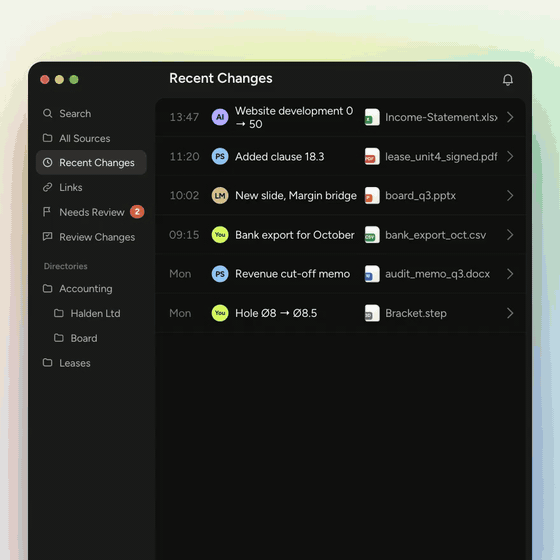
  </picture>
  <br><sub>Recent Changes opens each edit in place: the cells that were typed into first, then the formulas they recalculated.</sub>
</p>

Press `⇧⌘L` from any app to open The Loop, Lasso's library window. It shows every source in your folders and what has happened to them:

- **All Sources**, as a table or as cards, narrowed with a floating chip search (`F` or `⌘F`).
- **Recent Changes**, an audit log of who changed what and when. Each row opens to show the lines, cells or passages that changed.
- **Network**, a map of how your files connect, with the reason for each connection.
- **Links** you have shared, and items that **Need Review** because a source they rely on has changed.

<p align="center">
  <picture>
    <source media="(prefers-color-scheme: dark)" srcset="website/assets/media/loop-sources-dark.webp">
    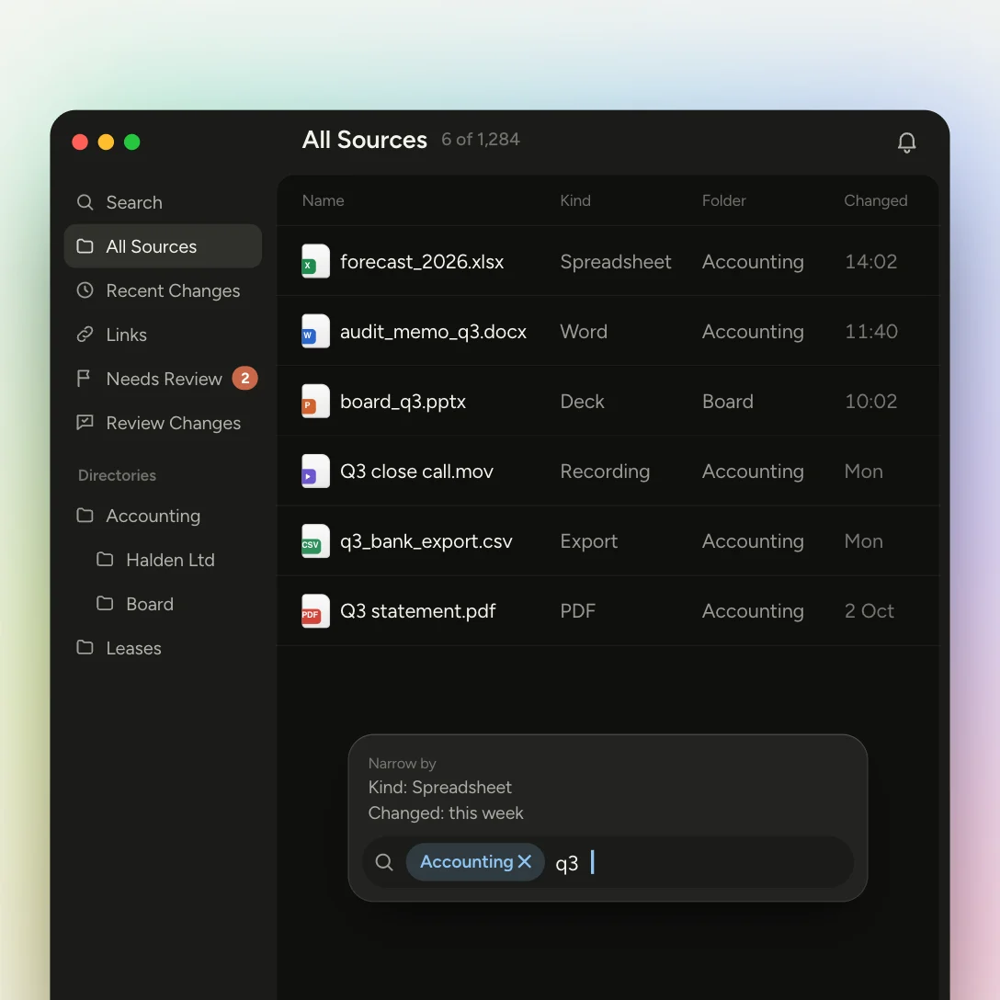
  </picture>
  <picture>
    <source media="(prefers-color-scheme: dark)" srcset="website/assets/media/loop-share-dark.webp">
    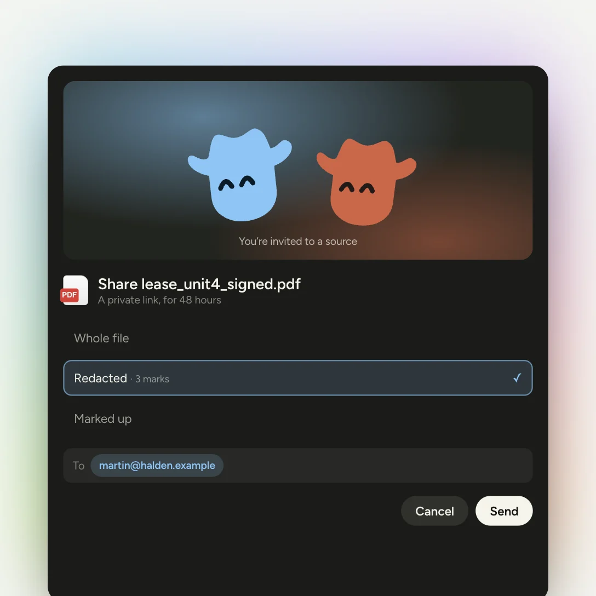
  </picture>
</p>

### Review Changes

<p align="center">
  <picture>
    <source media="(prefers-color-scheme: dark)" srcset="website/assets/media/loop-review-dark.webp">
    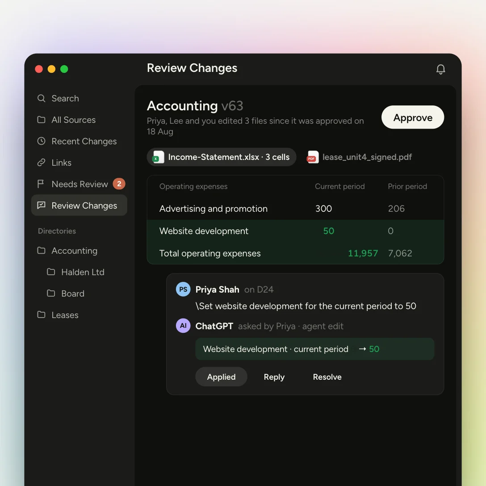
  </picture>
</p>

Review Changes brings pull-request style review to everyday files. It lists every file edited since the folder was last approved, with a tab per file:

- Comment on a line, a cell or a passage, reply, and resolve.
- Suggest a change and apply it as your own edit, including in `.xlsx`, `.csv` and older `.xls` workbooks.
- Start a comment with `\` and ChatGPT makes the change. The edit is recorded as the AI's, with who asked and the prompt.
- Ask named people to review, approve the folder, and undo an approval if you need to.

### Pick exactly what to insert

<p align="center">
  <picture>
    <source media="(prefers-color-scheme: dark)" srcset="website/assets/media/picker-dark.webp">
    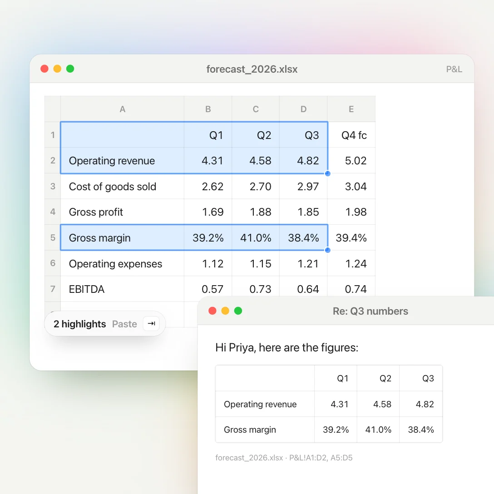
  </picture>
</p>

- **Sheet picker.** Press `fn Tab` on a spreadsheet or CSV suggestion to open its sheet. Drag to highlight cells (highlights don't have to touch), `⌘Z` removes the latest one, and `Tab` pastes a picture of those cells with their citation.
- **Passage picker.** Press `Tab` on a PDF, Word, deck, text or video passage to open the document with the matching words already highlighted. Adjust the highlight, then insert the text or a link.

### Provenance you can see

<p align="center">
  <picture>
    <source media="(prefers-color-scheme: dark)" srcset="website/assets/media/provenance-dark.webp">
    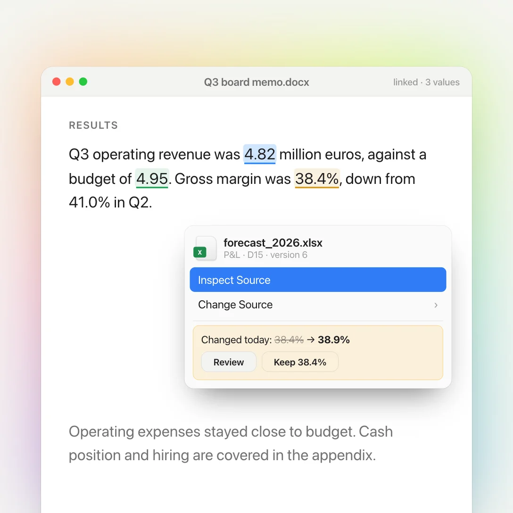
  </picture>
</p>

- **Source pills.** Inserted values are drawn as pills in their folder's colour. Click one to inspect the exact version it came from, or to swap in another source. When the file changes, Lasso shows the new value and lets you review or keep the old one. It never rewrites your document by itself.
- **AI-written text.** Text an AI wrote is marked with brackets in that AI's colour, and hovering shows a card with which AI wrote it and from what prompt. This comes from what the tools recorded when they wrote it (Claude Code, Lasso's own writer, and answers pasted from AI apps), never from guessing at the words. Word documents carry the record, signed, to anyone else who has Lasso.
- **Private share links.** Press `⇧⌘↩` to share the cited part, the whole file, or a redacted or marked-up copy through a link that expires after 48 hours. You can revoke it at any time from The Loop. Only what you share leaves your Mac.

### Dictation and AI agents

- **Dictation.** When you dictate with macOS Dictation, a glass pill with voice waves follows your words and grows into the suggestion card. Say "tab" to accept.
- **MCP for AI agents.** Claude Code, Claude Desktop, Cursor, ChatGPT and other MCP hosts can ask your Lasso folders instead of reading raw files. In live tests that used 73% fewer tokens. [Set it up](#lasso-mcp-for-ai-agents).

## How it works

<p align="center">
  
</p>

The Mac app reads the text before your caret through Accessibility and asks a local index server for matches. The server reads your files, keeps every version of them in SQLite, and ranks suggestions without calling any model. Nothing leaves your Mac unless you share a link, connect a cloud service, or send a prompt to your AI writer.

## Supported sources

| Kind | Formats and what Lasso does with them |
| --- | --- |
| **Spreadsheets and tables** | `.xlsx`, `.xlsm`, `.xls`, `.csv`, `.tsv`, `.ods` · values by row and column, follow-up values from the same row, recalculated formulas tracked, sheet picker |
| **Documents and decks** | `.pdf`, `.docx`, `.pptx`, `.md`, `.txt`, `.rtf` · sentence completion, page and slide previews, passage picker, changed words highlighted |
| **3D CAD and drawings** | `.step` / `.stp`, `.ifc`, `.dxf`, LandXML · part dimensions, assembly placements, 3D wireframe and floor-plan previews, alignment and pipe network tables |
| **Code and structured data** | Source code, `.json`, `.yaml`, `.xml`, `.ipynb` · file and symbol lookup, cite `line N` or `lines N-M` with the original indentation |
| **Recordings** | `.mov`, `.mp4`, `.m4v` · on-device transcription (macOS 26), quoted phrase search, playback from the exact moment |
| **Cloud drives** | Google Drive and shared drives, OneDrive and SharePoint (opt-in), Dropbox, iCloud Drive · read-only |
| **Drives and apps** | USB-A and USB-C drives on request · Outlook, Google Calendar, Calendar on your Mac, Notion, iCal feeds (opt-in) |

## System requirements

| | Requirement |
| --- | --- |
| **Operating system** | macOS 13.5 or later. Liquid Glass and on-device video transcription need macOS 26. Windows 10 (1809) or later is in preview. |
| **To build from source** | Node.js 24 or later, and the Xcode Command Line Tools |
| **Permissions** | Accessibility, granted once in System Settings, so Lasso can read and insert text |
| **For the MCP server** | Any MCP host: Claude Code, Claude Desktop, Cursor, ChatGPT and others |
| **Network** | Indexing, suggestions, The Loop and the local MCP server work offline. Cloud drives, connected apps, share links and the AI writer need an internet connection. |

The built app carries its own Node.js, so a Mac running `Lasso.app` needs nothing else installed.

## Install and run

Build the app from source:

```bash
git clone https://github.com/jte700/Lasso.git
cd Lasso
npm ci
npm run desktop
open dist/Lasso.app
```

Lasso appears in the menu bar and starts at login. If you quit it, press `⌘L` to start it again.

<details>
<summary>Run only the local index server, without the Mac app</summary>

```bash
npm ci
npm start                       # local server on http://127.0.0.1:4317
```
</details>

## How to use it

1. Click the Lasso icon in the menu bar and choose **Add Work Directories…** to pick the folders Lasso should read. You can also connect a cloud drive or an app, or plug in a USB drive.
2. Turn on **Suggest While Typing**, and allow Accessibility access when macOS asks.
3. Write in any app. When you type a name, a figure, a clause or a quoted phrase from your files, the card and ghost text appear by the caret.
4. Press `Tab` to insert, `↑` `↓` to choose another source, `fn Tab` on a spreadsheet to pick cells, or `⌥Tab` to choose a folder or an AI writer.
5. Press `⇧⌘L` from any app to open **The Loop** and see your sources, recent changes, reviews and shared links.

The [user guide](docs/user-guide.md) covers sharing, redaction, cloud drives, connected apps, USB drives, dictation and CAD sources in more detail.

## Keyboard shortcuts

**While writing, or with a suggestion card showing**

| Keys | Action |
| --- | --- |
| `Tab` | Insert the suggestion (on a passage, open its document to highlight the exact words) |
| `↑` `↓` | Choose another suggestion or source |
| `fn →` / `fn ←` | Look inside the selected source or sheet values / step back |
| `⇧fn →` / `⇧fn ←` | Choose which words of a highlighted line to insert |
| `fn Tab` | Open a spreadsheet or CSV suggestion in the sheet picker |
| `⌥Tab` | Switch between All and one folder or app; `↓` chooses the AI writer |
| Hold `⌥Tab` | List your switched-on folders to pick from |
| `\ …` then `Tab` | Send the sentence to your AI writer as a prompt |
| `⌘↩` | Insert with a local link to the source, never as a share link |
| `⇧⌘↩` | Share the cited source as an expiring private link |
| `⌘Z` | Undo what Lasso or the AI writer just inserted |
| `Esc` | Dismiss for the current sentence, or stop the AI writer |

**Anywhere**

| Keys | Action |
| --- | --- |
| `⇧⌘L` | Open The Loop |
| `⌘L` | Start Lasso again after quitting |
| `⌘,` | Settings |

In The Loop, `⌘1` to `⌘5` switch pages, `⌘F` opens search, and `↑` `↓` / `→` `←` move through Recent Changes and open or close a change. The full list is in **Settings → Shortcuts**.

## Lasso in the terminal

`lasso` answers provenance questions about any file on your computer, on the spot. For files in your Lasso folders it reads the history the Mac app keeps (who changed what, and when); for every other file it reads what the file and the system already know: the address it was downloaded from, the app that wrote it, who created and last saved it, identical copies elsewhere on the Mac, files named like it, and git. Nothing is indexed or kept, and without the app it never writes a library. No language model is involved.

Lasso.app puts `lasso` on your PATH each time it starts, so after installing or rebuilding the app, open a new Terminal window and type `lasso`. The app links its own copy (with its own Node.js) into `/usr/local/bin`, or into `/opt/homebrew/bin` when only Homebrew's folder can be written. Where neither can be written without your password, **Settings → General → Advanced → Terminal command → Install…** asks for it. A `lasso` you linked yourself is left alone.

To run the checkout's own copy instead, from this folder:

```bash
npm ci && npm link                        # needs Node.js 24 or later; links `lasso` to this folder
```

```bash
lasso                                     # the interactive shell (type / for commands, or drop in a file)
lasso whence ~/Downloads/q3.xlsx          # where a file came from: Lasso's record, this Mac, the file itself, its copies
lasso diff budget.xlsx "budget final.xlsx"  # two files compared cell by cell (or line by line, passage by passage)
lasso verify memo.docx --against ~/Desktop/Accounting   # every number checked against its sources; exits 1 if one is stale
lasso blame notes.docx                    # who wrote what: Lasso's record, Word's tracked changes, or git blame
lasso log ~/Desktop --since 2d            # what changed lately in any folder
lasso hooks install                       # record what Claude Code writes into your Lasso folders
```

Every answer says what an AI wrote, from what the tools recorded when they wrote it, never guessed from the words. For files in your Lasso folders that is the app's record: Claude Code's edits (once `lasso hooks install` has added Lasso's hook to Claude Code's settings), answers from Lasso's writer, and answers pasted from AI apps. `whence` gives each AI's share of the text and the prompt that asked for it, `blame` lists each part, `diff` marks the lines an AI wrote, and `log` names what an AI wrote in each save. For any other file it is what the file and git say of themselves: an image's IPTC source type and Content Credentials (ChatGPT's images name ChatGPT), Stable Diffusion's or ComfyUI's generation settings in a PNG, and commits that name an AI as author or co-author.

Add `--json` for scripts. `lasso help` lists every command.

## Lasso MCP for AI agents

The Lasso MCP server lets an AI agent ask your local index instead of reading raw files. One tool returns the exact lines, cells, passages or computed totals with their source locations and revision state.

**Claude Code**

```bash
claude mcp add lasso -- node /path/to/Lasso/src/agent/cli.js mcp --scope Finance
```

**Claude Desktop and other hosts** (`mcpServers` in the host config)

```json
{
  "mcpServers": {
    "lasso": {
      "command": "/Applications/Lasso.app/Contents/MacOS/node",
      "args": ["/Applications/Lasso.app/Contents/Resources/app/src/agent/cli.js", "mcp", "--scope", "Finance"]
    }
  }
}
```

`--scope` names the folders the agent may read (repeat for multiple folders, or `"*"` for all enabled folders). Add the folders in Lasso first. Setup, REST API and tool reference: [docs/agent](docs/agent/README.md).

## Benchmarks

### Token savings & accuracy with Lasso MCP

The same models answered identical tasks twice: once with file tools only (`Read`, `Grep`, `Glob`), once with Lasso's MCP server added. Token counts and costs come directly from provider usage records for every call (prompts, tool definitions, conversation and reasoning included).

| Run | Tasks | Tokens, file tools | Tokens, Lasso MCP | Saved | Cost | Correct |
| --- | ---: | ---: | ---: | ---: | --- | --- |
| **gpt-5.4-mini, pooled mix** | 92 | 1,131,635 | 302,992 | **73%** | \$0.648 → \$0.291 (**55%**) | 62 → **75** |
| gpt-5.4-mini, lookups | 32 | 219,302 | 67,439 | **69%** | \$0.145 → \$0.080 (**45%**) | 29 → **32** |
| gpt-5.3-codex, lookups | 15 | 127,293 | 29,777 | **77%** | \$0.211 → \$0.100 (**52%**) | 13 → **15** |

<p align="center"></p>

Savings depend on file size and structure. Large spreadsheets, multi-page reports and 3D assemblies gain the most; very small 1 to 2 page PDFs are cheaper to read directly.

<p align="center"></p>

### Typing speed & accuracy

Replaying 28 prompts one keystroke at a time across 10 test folders (577 keystrokes, 5,216 indexed items indexed in 11.4 s on an Apple M3):

- **27 of 28** prompts ranked the right source first; **28 of 28** within the top three.
- **7.0 ms** median and **19 ms** p95 per keystroke with all 10 folders on (**0.8 ms** median with one folder).
- **0** model tokens: typing suggestions never call a language model.

<p align="center"></p>

Folders with more than 25,000 indexed objects use a compact on-disk search index (`derived/search-index`) so lookups stay bounded without holding every object in memory.

### History storage, edit speed & memory

Every file version is stored content-addressed in SQLite so provenance stays exact over time. Following the indexing rework (`npm run bench:storage` on a 1,882-row, 614 KB CSV):

- **4 KB** database growth per 1-cell edit (3 version rows written), down from **1.5 MB** (1,882 rows), with **0 B** derived table growth.
- **404 of 404** row identities preserved when a row is inserted at the top (up from 4 of 404).
- **128 ms** warm edit and **143 ms** first edit after restart (down from 303 ms); **90.5 MB** idle RSS with a shared 64 MB cache budget (shrinking to 8 MB idle) and zstd compression on superseded text versions.

<p align="center">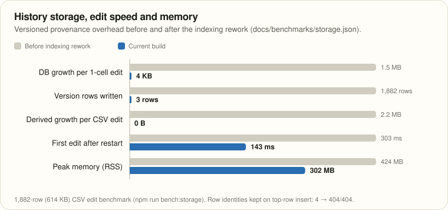</p>

<details>
<summary>Methodology and reproducing the numbers</summary>

- **MCP runs:** [`scripts/agent-benchmark-live.mjs`](scripts/agent-benchmark-live.mjs), low reasoning effort, graded against known answers. Full records: [gpt-5.4-mini lookups](docs/agent/live-results-gpt-5.4-mini-v4.md), [gpt-5.3-codex lookups](docs/agent/live-results-gpt-5.3-codex-v4.md), [by kind of file](docs/agent/live-results-gpt-5.4-mini-geometry+scale+writing+documents.md), [post-fix mid-size reports (heldout2)](docs/agent/live-results-gpt-5.4-mini-documents-mcp-heldout2.md) and [(heldout3)](docs/agent/live-results-gpt-5.4-mini-documents-mcp-heldout3.md). Pooled totals combine the 92 current live questions on `gpt-5.4-mini` (excluding the superseded pre-fix 8 to 9 page PDF run), matching [`docs/benchmarks/mcp-summary.json`](docs/benchmarks/mcp-summary.json).
- **Typing runs:** `npm run bench` replays [`scripts/benchmark-cases.json`](scripts/benchmark-cases.json) against a temporary library and writes [`docs/benchmarks/results.json`](docs/benchmarks/results.json).
- **Storage & memory runs:** `npm run bench:storage` writes [`docs/benchmarks/storage.json`](docs/benchmarks/storage.json).
- **Charts:** `npm run bench:charts` redraws every SVG in `docs/benchmarks/` from those JSON files.
</details>

## Documentation & development

[User guide](docs/user-guide.md) · [MCP & agent API](docs/agent/README.md) · [Building & configuration](docs/building.md) · [Reader contract](docs/reader-contract.md) · [Ranking algorithm (PDF)](docs/lasso-ranking-algorithm.pdf) · [Known limitations](docs/limitations.md)

**Tests:** `npm test` runs the **1,407**-test Node suite, and `npm run desktop:test` runs **1,615** native Swift checks.

**Source layout:** `src/` local index server, MCP server, AI writer and review service · `desktop/` native macOS app (Swift / AppKit / SwiftUI) · `desktop/windows/` and `desktop-windows/` Windows preview · `public/` Connect Apps and browser workbench UI · `test/` automated tests · `docs/` guides and benchmark records.
