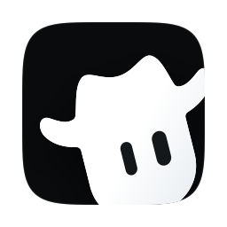
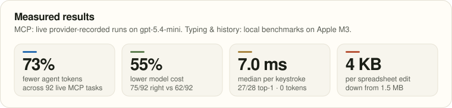
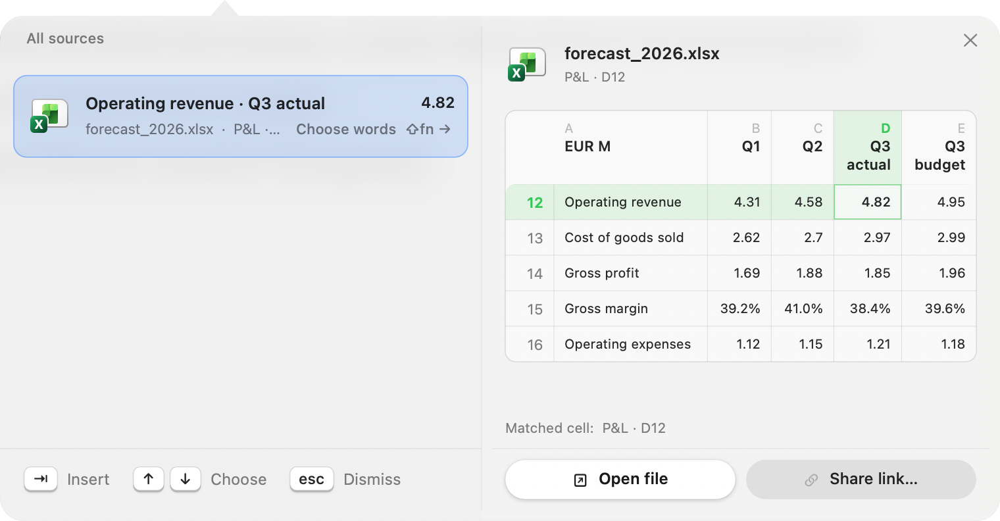
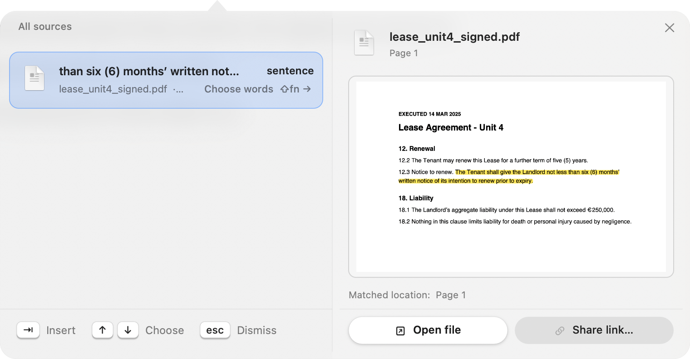
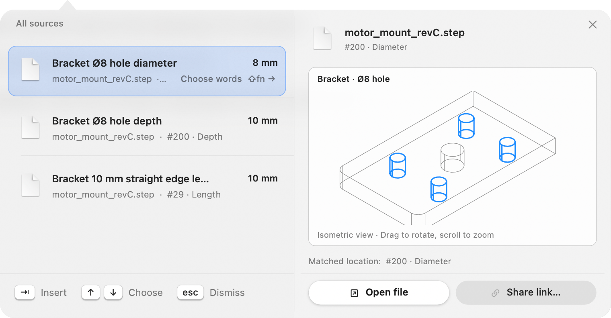
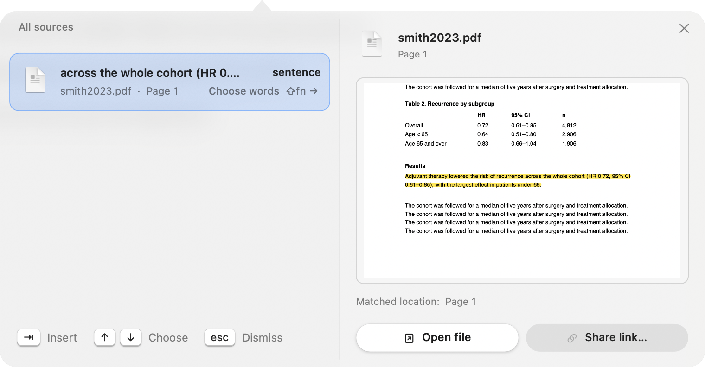
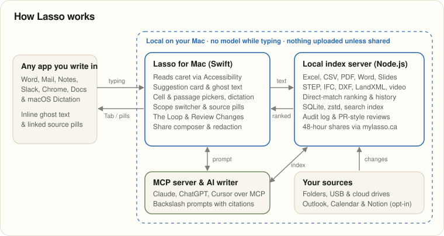
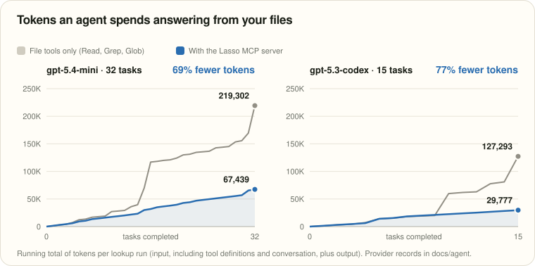
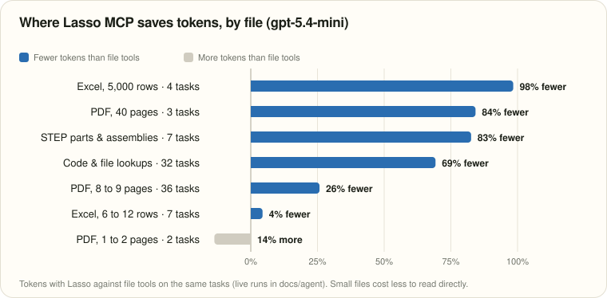
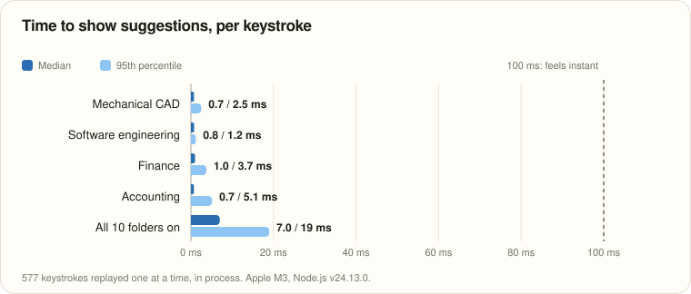

<p align="center">
  
</p>

<h1 align="center">Lasso</h1>

<p align="center"><b>The right figure, from the right file.</b><br>Autocomplete exact figures, clauses and passages from your own files in any Mac app, with versioned provenance, an AI writer, review workflows, and a local MCP server.</p>

<p align="center">
  <a href="https://mylasso.ca">Website</a> ·
  <a href="#what-lasso-does">Features</a> ·
  <a href="#install-and-run">Install</a> ·
  <a href="#keyboard-shortcuts">Shortcuts</a> ·
  <a href="#lasso-mcp-for-ai-agents">MCP for AI agents</a> ·
  <a href="#benchmarks">Benchmarks</a> ·
  <a href="docs/user-guide.md">User guide</a>
</p>

<p align="center">
  
</p>

<p align="center">
  <picture>
    <source media="(prefers-color-scheme: dark)" srcset="docs/images/card-excel-dark.png">
    
  </picture>
  <br><sub>Typing in any app surfaces the exact cell from <code>forecast_2026.xlsx</code> in its sheet before <code>Tab</code> inserts it, with its source version attached.</sub>
</p>

<details>
<summary><b>More examples</b>: PDF contracts, STEP 3D models, IFC floor plans, research reports, and how Lasso works</summary>
<br>
<p align="center">
  <picture>
    <source media="(prefers-color-scheme: dark)" srcset="docs/images/card-pdf-dark.png">
    
  </picture>
  <br><sub>From a signed PDF lease: the clause completed word for word, highlighted on its page.</sub>
</p>
<p align="center">
  <picture>
    <source media="(prefers-color-scheme: dark)" srcset="docs/images/card-cad-dark.png">
    
  </picture>
  <br><sub>From a STEP assembly: exact part dimensions with an interactive 3D wireframe of the highlighted feature.</sub>
</p>
<p align="center">
  <picture>
    <source media="(prefers-color-scheme: dark)" srcset="docs/images/card-ifc-dark.png">
    
  </picture>
  <br><sub>From an IFC building model: room areas and quantities with the room highlighted on its floor plan.</sub>
</p>
<p align="center">
  <picture>
    <source media="(prefers-color-scheme: dark)" srcset="docs/images/card-report-dark.png">
    
  </picture>
  <br><sub>From a PDF report: exact findings and confidence intervals, matched straight from the page.</sub>
</p>
<p align="center">
  
</p>
</details>

## What Lasso does

Lasso indexes the folders you choose on your Mac and offers exact values, clauses and passages while you write in any app. Press `Tab` to insert one, with a link back to the file and version it came from.

- **Exact autocomplete & inline ghost text.** Suggestions are verbatim text and measured values from your files, never generated by a language model. Matching completions preview inline as ghost text after the caret and in a Liquid Glass card with live sheet, page, slide, CAD or video previews.
- **Cell & passage pickers.** Press `fn Tab` on a spreadsheet or CSV suggestion to open its sheet, drag over non-contiguous cells (`⌘Z` undoes the latest highlight), and press `Tab` to paste them as a formatted table picture with its citation. Press `Tab` on a document, slide or video passage to highlight the exact words before inserting.
- **Provenance pills.** Inserted values render as pills in their folder's colour. Click any pill to inspect its exact versioned source or swap to another source the card offered; when an underlying file changes, Lasso flags what relied on it without rewriting your document.
- **AI writer (opt-in).** Choose an AI writer with `⌥Tab ↓` (ChatGPT via your own account). Start any sentence with `\` and press `Tab`: the writer queries your local Lasso index, writes in place with linked source pills, stops on `Esc`, and reverts cleanly on `⌘Z`.
- **The Loop & Review Changes (`⇧⌘L`).** Lasso's library window in a dark Figtree UI: a live **Recent Changes** audit log (typed cell edits first, recalculated formula cells folded, inline diffs), **Review Changes** (PR-style file tabs for edits since last approval, line/cell/passage comments, Apply edits including `.xls`, `\...` AI edits, Add Reviewers, Approve and Undo), morphing chip search (`⌘F`), active share links, and items needing review.
- **Private expiring share links (`⇧⌘↩`).** Share the exact cited part, the whole file, or a redacted/marked-up copy through a 48-hour link on `mylasso.ca`, revocable at any time from The Loop. Only content you explicitly share leaves your Mac.
- **Dictation, USB drives, source scopes & connected apps.** A voice-wave glass pill follows macOS Dictation and morphs into the card as you speak (say "tab" to accept). Plug in any USB drive and Lasso asks whether to index the drive or chosen folders. Press `⌥Tab` to narrow suggestions to one folder or opt-in connected app (Outlook, Google Calendar, Apple Calendar, Notion, iCal feeds).
- **Local MCP server for AI agents.** Gives Claude Code, Claude Desktop, Cursor and ChatGPT one local tool over your scoped folders, saving 73% of tokens across 92 live tasks.

## Supported sources

| Kind | Formats & capabilities |
| --- | --- |
| **Spreadsheets & tables** | `.xlsx`, `.xlsm`, `.xls`, `.csv`, `.tsv`, `.ods` · row/column value lists, row-mate follow-ups, formula recalculation tracking, cell picker (`fn Tab`), whole-table MCP queries |
| **Documents & decks** | `.pdf`, `.docx`, `.pptx`, `.md`, `.txt`, `.rtf` · sentence completion, live page & slide previews, passage picker, word-level change highlights |
| **3D CAD & drawings** | `.step` / `.stp`, `.ifc`, `.dxf`, `.xml` (LandXML) · part dimensions, assembly placements, interactive 3D wireframe and floor-plan previews |
| **Code & structured data** | Source code, `.json`, `.yaml`, `.xml`, `.ipynb` · filename and symbol lookup, cite by `line N` or `lines N-M` with original indentation |
| **Video recordings** | `.mov`, `.mp4`, `.m4v` · on-device speech transcription (macOS 26), quoted phrase search, in-card playback cued to the exact moment |
| **Connected apps & drives** | Outlook, Google Calendar, Apple Calendar, Notion, iCal feeds (opt-in) · external USB-A / USB-C drives indexed on request |

## System requirements

| | Requirement |
| --- | --- |
| **Operating system** | macOS 13.5 or later (Liquid Glass UI and on-device video transcription on macOS 26). Windows 10 (1809) or later is in preview. |
| **To build from source** | Node.js 24 or later, and the Xcode Command Line Tools |
| **Permissions** | Accessibility, granted once in System Settings, so Lasso can read and insert text |
| **For the MCP server** | Any MCP host: Claude Code, Claude Desktop, Cursor, ChatGPT and others |
| **Network** | Indexing, suggestions, The Loop and local MCP work offline. Hosted shares (`mylasso.ca`), connected apps and the opt-in AI writer need internet access. |

The built Mac app bundles its own Node.js runtime, so a Mac running `Lasso.app` needs nothing else installed.

## Install and run

```bash
git clone https://github.com/jte700/Lasso.git
cd Lasso
npm ci
npm run desktop
open dist/Lasso.app
```

Lasso appears in the menu bar and launches at login. After quitting, press `⌘L` to start it again.

<details>
<summary>Run only the local index server, without the Mac app</summary>

```bash
npm ci
npm start                       # opens local server on http://127.0.0.1:4317
```
</details>

## How to use it

1. Click the Lasso icon in the menu bar and choose **Add Work Directories…** to pick the folders Lasso should watch (or connect an app / plug in a USB drive).
2. Turn on **Suggest While Typing**, and grant Accessibility access when macOS prompts.
3. Write in any app. As you type a name, figure, clause or quoted phrase from your files, ghost text and the suggestion card appear by the caret.
4. Press `Tab` to insert, `↑` `↓` to pick another source, `fn Tab` on a spreadsheet to highlight cells, or `⌥Tab` to narrow to one folder or enable the AI writer.
5. Press `⇧⌘L` from any app to open **The Loop**: browse every source, inspect recent changes, review edits, and manage shared links.

The [user guide](docs/user-guide.md) covers sharing, redaction, connected apps, USB drives, dictation, and CAD sources in detail.

## Keyboard shortcuts

**While writing or with a suggestion card showing**

| Keys | Action |
| --- | --- |
| `Tab` | Insert the suggestion (on a passage, opens its document to highlight exact words) |
| `↑` `↓` | Choose another suggestion or source |
| `fn →` / `fn ←` | Dive into the selected source or sheet values / step back |
| `⇧fn →` / `⇧fn ←` | Choose which words of a highlighted line to insert |
| `fn Tab` | Open a spreadsheet or CSV suggestion in the cell picker |
| `⌥Tab` | Switch source scope (All or one folder/app); `↓` chooses the AI writer |
| `\ …` then `Tab` | Send the sentence to the selected AI writer as a prompt |
| `⌘↩` | Insert with local provenance tracking, never as a share link |
| `⇧⌘↩` | Share the cited reference as an expiring private link |
| `⌘Z` | Undo what Lasso or the AI writer just inserted |
| `Esc` | Dismiss for the current word (or stop the AI writer) |

**Anywhere**

| Keys | Action |
| --- | --- |
| `⇧⌘L` | Open The Loop |
| `⌘L` | Start Lasso again after quitting |
| `⌘,` | Settings |

In The Loop, `⌘1` to `⌘5` switch views, `⌘F` opens morphing chip search, and `↑` `↓` / `→` `←` step through and expand Recent Changes. The complete list is in **Settings → Shortcuts**.

## Lasso in the terminal

`lasso` answers provenance questions about any file on your computer, on the spot. For files in your Lasso folders it reads the history the Mac app keeps (who changed what, and when); for every other file it reads what the file and the system already know: the address it was downloaded from, the app that wrote it, who created and last saved it, identical copies elsewhere on the Mac, files named like it, and git. Nothing is indexed or kept, and without the app it never writes a library. No language model is involved.

Lasso.app puts `lasso` on your PATH each time it starts, so after installing or rebuilding the app, open a new Terminal window and type `lasso`. The app links its own copy (with its own Node.js) into `/usr/local/bin`, or into `/opt/homebrew/bin` when only Homebrew's folder can be written. Where neither can be written without your password, **Settings → General → Advanced → Terminal command → Install…** asks for it. A `lasso` you linked yourself is left alone.

To run the checkout's own copy instead, from this folder:

```bash
npm ci && npm link                        # needs Node.js 24 or later; links `lasso` to this folder
```

```bash
lasso                                     # the interactive shell (type / for commands, or drop in a file)
lasso whence ~/Downloads/q3.xlsx          # where a file came from: Lasso's record, this Mac, the file itself, its copies
lasso diff budget.xlsx "budget final.xlsx"  # two files compared cell by cell (or line by line, passage by passage)
lasso verify memo.docx --against ~/Desktop/Accounting   # every number checked against its sources; exits 1 if one is stale
lasso blame notes.docx                    # who wrote what: Lasso's record, Word's tracked changes, or git blame
lasso log ~/Desktop --since 2d            # what changed lately in any folder
lasso hooks install                       # record what Claude Code writes into your Lasso folders
```

Every answer says what an AI wrote, from what the tools recorded when they wrote it, never guessed from the words. For files in your Lasso folders that is the app's record: Claude Code's edits (once `lasso hooks install` has added Lasso's hook to Claude Code's settings), answers from Lasso's writer, and answers pasted from AI apps. `whence` gives each AI's share of the text and the prompt that asked for it, `blame` lists each part, `diff` marks the lines an AI wrote, and `log` names what an AI wrote in each save. For any other file it is what the file and git say of themselves: an image's IPTC source type and Content Credentials (ChatGPT's images name ChatGPT), Stable Diffusion's or ComfyUI's generation settings in a PNG, and commits that name an AI as author or co-author.

Add `--json` for scripts. `lasso help` lists every command.

## Lasso MCP for AI agents

The Lasso MCP server lets an AI agent ask your local index instead of reading raw files. One tool returns the exact lines, cells, passages or computed totals with their source locations and revision state.

**Claude Code**

```bash
claude mcp add lasso -- node /path/to/Lasso/src/agent/cli.js mcp --scope Finance
```

**Claude Desktop and other hosts** (`mcpServers` in the host config)

```json
{
  "mcpServers": {
    "lasso": {
      "command": "/Applications/Lasso.app/Contents/MacOS/node",
      "args": ["/Applications/Lasso.app/Contents/Resources/app/src/agent/cli.js", "mcp", "--scope", "Finance"]
    }
  }
}
```

`--scope` names the folders the agent may read (repeat for multiple folders, or `"*"` for all enabled folders). Add the folders in Lasso first. Setup, REST API and tool reference: [docs/agent](docs/agent/README.md).

## Benchmarks

### Token savings & accuracy with Lasso MCP

The same models answered identical tasks twice: once with file tools only (`Read`, `Grep`, `Glob`), once with Lasso's MCP server added. Token counts and costs come directly from provider usage records for every call (prompts, tool definitions, conversation and reasoning included).

| Run | Tasks | Tokens, file tools | Tokens, Lasso MCP | Saved | Cost | Correct |
| --- | ---: | ---: | ---: | ---: | --- | --- |
| **gpt-5.4-mini, pooled mix** | 92 | 1,131,635 | 302,992 | **73%** | \$0.648 → \$0.291 (**55%**) | 62 → **75** |
| gpt-5.4-mini, lookups | 32 | 219,302 | 67,439 | **69%** | \$0.145 → \$0.080 (**45%**) | 29 → **32** |
| gpt-5.3-codex, lookups | 15 | 127,293 | 29,777 | **77%** | \$0.211 → \$0.100 (**52%**) | 13 → **15** |

<p align="center"></p>

Savings depend on file size and structure. Large spreadsheets, multi-page reports and 3D assemblies gain the most; very small 1 to 2 page PDFs are cheaper to read directly.

<p align="center"></p>

### Typing speed & accuracy

Replaying 28 prompts one keystroke at a time across 10 test folders (577 keystrokes, 5,216 indexed items indexed in 11.4 s on an Apple M3):

- **27 of 28** prompts ranked the right source first; **28 of 28** within the top three.
- **7.0 ms** median and **19 ms** p95 per keystroke with all 10 folders on (**0.8 ms** median with one folder).
- **0** model tokens: typing suggestions never call a language model.

<p align="center"></p>

Folders with more than 25,000 indexed objects use a compact on-disk search index (`derived/search-index`) so lookups stay bounded without holding every object in memory.

### History storage, edit speed & memory

Every file version is stored content-addressed in SQLite so provenance stays exact over time. Following the indexing rework (`npm run bench:storage` on a 1,882-row, 614 KB CSV):

- **4 KB** database growth per 1-cell edit (3 version rows written), down from **1.5 MB** (1,882 rows), with **0 B** derived table growth.
- **404 of 404** row identities preserved when a row is inserted at the top (up from 4 of 404).
- **128 ms** warm edit and **143 ms** first edit after restart (down from 303 ms); **90.5 MB** idle RSS with a shared 64 MB cache budget (shrinking to 8 MB idle) and zstd compression on superseded text versions.

<p align="center"></p>

<details>
<summary>Methodology and reproducing the numbers</summary>

- **MCP runs:** [`scripts/agent-benchmark-live.mjs`](scripts/agent-benchmark-live.mjs), low reasoning effort, graded against known answers. Full records: [gpt-5.4-mini lookups](docs/agent/live-results-gpt-5.4-mini-v4.md), [gpt-5.3-codex lookups](docs/agent/live-results-gpt-5.3-codex-v4.md), [by kind of file](docs/agent/live-results-gpt-5.4-mini-geometry+scale+writing+documents.md), [post-fix mid-size reports (heldout2)](docs/agent/live-results-gpt-5.4-mini-documents-mcp-heldout2.md) and [(heldout3)](docs/agent/live-results-gpt-5.4-mini-documents-mcp-heldout3.md). Pooled totals combine the 92 current live questions on `gpt-5.4-mini` (excluding the superseded pre-fix 8 to 9 page PDF run), matching [`docs/benchmarks/mcp-summary.json`](docs/benchmarks/mcp-summary.json).
- **Typing runs:** `npm run bench` replays [`scripts/benchmark-cases.json`](scripts/benchmark-cases.json) against a temporary library and writes [`docs/benchmarks/results.json`](docs/benchmarks/results.json).
- **Storage & memory runs:** `npm run bench:storage` writes [`docs/benchmarks/storage.json`](docs/benchmarks/storage.json).
- **Charts:** `npm run bench:charts` redraws every SVG in `docs/benchmarks/` from those JSON files.
</details>

## Documentation & development

[User guide](docs/user-guide.md) · [MCP & agent API](docs/agent/README.md) · [Building & configuration](docs/building.md) · [Reader contract](docs/reader-contract.md) · [Ranking algorithm (PDF)](docs/lasso-ranking-algorithm.pdf) · [Known limitations](docs/limitations.md)

**Tests:** `npm test` runs the **1,407**-test Node suite, and `npm run desktop:test` runs **1,615** native Swift checks.

**Source layout:** `src/` local index server, MCP server, AI writer and review service · `desktop/` native macOS app (Swift / AppKit / SwiftUI) · `desktop/windows/` and `desktop-windows/` Windows preview · `public/` Connect Apps and browser workbench UI · `test/` automated tests · `docs/` guides and benchmark records.
